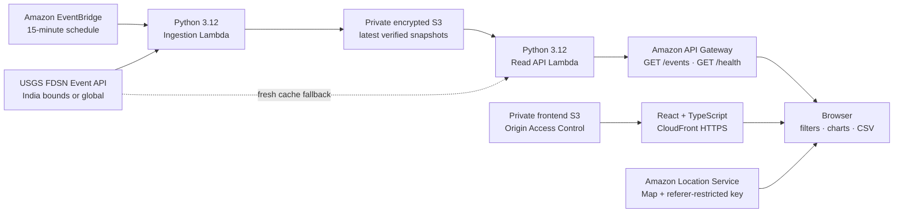

# QuakeWatch AI

**Real-Time Earthquake Intelligence Through Interactive Geospatial Mapping**

QuakeWatch AI is a responsive dashboard for exploring **real earthquake
records from the USGS Earthquake Catalog**. It starts with India and
surrounding regions, with a global exploration view, interactive map
clustering, magnitude/depth/date/location filters, event details, activity
charts, and CSV export.

> **Safety note:** This is an informational catalog visualization. It does not
> predict earthquakes, issue early warnings, or replace official emergency
> guidance.

| Status | Verified in this workspace |
|---|---|
| Live catalog | Official USGS FDSN API is queried with bounded timeouts; no sample events are included |
| Local map | A clearly labelled OpenStreetMap preview is used during Vite development |
| AWS map | CDK defines an Amazon Location Service map and restricted, expiring key; deployment is not verified |
| AWS backend/hosting | CDK v2 definitions and a verified deployment script are included; not deployed without AWS credentials and approval |
| Public application URL | Not available until an AWS deployment is completed and checked |
| Public GitHub URL | [Public repository](https://github.com/MOHBGS/quakewatch-ai) — source code and documentation published |
| Screenshots | No screenshots are claimed; see [screenshots/README.md](./screenshots/README.md) |
| Repository audit | [Verified features, findings, and deployment limitations](./docs/PROJECT_AUDIT.md) |
| Architecture | [AWS/local system design and data flow](./docs/ARCHITECTURE.md) |
| Hackathon package | [Submission draft](./docs/HACKATHON_SUBMISSION.md), [data source](./docs/DATA_SOURCE.md), and [demo script](./docs/DEMO_SCRIPT.md) |
| Deployment report | [AWS access and deployment status](./docs/DEPLOYMENT_REPORT.md) |

## Problem statement

Raw earthquake catalog feeds are accurate, but it can take effort to relate
individual event coordinates, magnitudes, timestamps, depths, and places to
regional and temporal patterns. QuakeWatch AI presents those public
observations together, linking every event to its original USGS catalog page.

## Main features

- India-focused interactive map, global view, zoom, pan, magnitude-colored
  event markers, and marker clustering.
- Optional map heatmap for event density; this reflects only the current
  filtered catalog, not earthquake risk or a prediction.
- Filters for region, magnitude range, event depth, UTC date range, and
  location text; filter state is preserved in shareable query parameters.
- Clickable event details with source links, magnitude, type, depth, and
  recorded time.
- Event counts, strongest/mean magnitude, mean known depth, most recent
  activity, magnitude distribution, and UTC daily timeline.
- Downloadable CSV for every matching event with source and export timestamp.
  Formula-leading source text is escaped for spreadsheet applications.
- Refresh status, stale-data warning, bounded polling, useful error states,
  and **no fabricated fallback data**.
- Responsive layouts and keyboard-accessible controls.

## Screenshots

No screenshots have been captured from this running implementation yet. The
[`screenshots/`](./screenshots) folder is reserved for authentic screenshots
after running and verifying the app; no mockup is presented as an
implementation or deployment screenshot.

## Live demo

No public deployment has been verified. A public URL will be added only after
the CloudFormation deployment, application/API smoke tests, and HTTPS URL
check succeed.

## Technology stack

| Area | Technologies |
|---|---|
| Frontend | React, TypeScript, Vite, Tailwind CSS, Recharts, MapLibre GL JS |
| Geospatial | Amazon Location Service (CDK-defined, not deployed), MapLibre GL JS; local OpenStreetMap preview |
| Backend | Python 3.12 AWS Lambda, Python standard library |
| APIs and storage | Amazon API Gateway, private Amazon S3 |
| Scheduling | Amazon EventBridge |
| Hosting | Amazon CloudFront with S3 Origin Access Control |
| Infrastructure | AWS CDK v2, TypeScript |
| Testing and CI | Vitest, Python `unittest`, CDK synthesis/assertions, GitHub Actions |
| Data | Official USGS Earthquake Catalog FDSN API |

## Architecture



In the local preview, the browser queries USGS directly and uses an explicitly
labelled OpenStreetMap base layer; this is **not represented as an AWS-hosted
map or deployment**. See [data source and normalization](./docs/DATA_SOURCE.md).

## Requirements

- Node.js 22.12+ and npm 10+.
- Python 3.12+ for the target Lambda runtime and test suite.
- An internet connection to reach the official USGS feed; AWS credentials are
  not required for local development.
- To deploy: AWS CLI v2, CDK bootstrap, CDK v2 permissions, and a permitted
  AWS account/region. The AWS map key is optional for local use and required
  for the production Amazon Location map.

## Installation

From the repository root:

```powershell
npm ci
```

Or, on first install without a lockfile, use `npm install`. Python handlers and
tests use the standard library, so no backend dependency installation is
needed. `backend/requirements.txt` documents the Lambda runtime-provided
`boto3` dependency.

Copy `.env.example` to `.env.local` in the repository root to configure a
custom API/map. Vite loads this root file; keep `.env.local` untracked.

## Run locally

In terminal 1, start the real-data local API:

```powershell
python -m backend.local_server
```

In terminal 2:

```powershell
npm run dev
```

Open the localhost URL printed by Vite. Add
`VITE_API_BASE_URL=http://127.0.0.1:8000` to `.env.local` to use the local
Python API. Without that setting, the browser queries the public USGS API
directly. The map shows a visible local OpenStreetMap attribution and fallback
label until a map key is configured; it never silently claims to be Amazon
Location.

## Environment variables

| Variable | Required | Purpose |
|---|---:|---|
| `VITE_API_BASE_URL` | No | API Gateway or local API base URL; `/events` is appended by the client |
| `VITE_AWS_REGION` | No | Region containing the Amazon Location map (defaults to `us-east-1`) |
| `VITE_AMAZON_LOCATION_MAP_NAME` | For AWS map | Deployed Amazon Location map resource name |
| `VITE_AMAZON_LOCATION_API_KEY` | For AWS map | Browser-visible key restricted to this map and allowed referrers |
| `VITE_MAP_PROVIDER` | No | Set `osm` for an explicit local preview; do not use as a production map substitute |
| `AWS_REGION` | For CDK | AWS deployment region (defaults to `us-east-1` if not set) |

A browser-visible `VITE_` value is not a secret. Do not put AWS credentials,
GitHub tokens, AWS access keys, or the unrestricted output of a map key in
source control. `.env*` is ignored other than `.env.example`. The deploy
script retrieves the map key into process memory and does not print it.

## AWS architecture and deployment

The CDK app provisions:

- Two private, encrypted, retained S3 buckets: USGS snapshots and the static
  dashboard. Both block all public access.
- Two Python 3.12 Lambda functions with scoped S3 grants and short log
  retention: scheduled USGS ingestion and the public read-only API.
- API Gateway GET endpoints and public CORS for these non-personal public data
  records, with API throttles.
- Two EventBridge rules refreshing India/global USGS snapshots every 15
  minutes.
- An Amazon Location Service map and map-render-only API key restricted to the
  map ARN and deployed CloudFront hostname, with a deployment-time expiry.
- A CloudFront HTTPS distribution with a private S3 origin.

### Cost exposure

Before deploying, review potential usage charges for map requests, CloudFront
requests/transfer, API Gateway, Lambda, S3, EventBridge, and CloudWatch logs.
CDK bootstrap may create a deployment bucket and roles. The stack intentionally
does not guess or claim a monthly estimate: current costs depend on account,
region, map traffic, and usage. Review [AWS pricing](https://calculator.aws/)
and [cost/security guidance](./docs/aws-costs-and-security.md), and configure
an AWS Budget before launch. The deployment script prints this warning and
requires you to type `DEPLOY` before it provisions resources.

### Deploy from PowerShell

1. Install AWS CLI v2 and AWS CDK prerequisites.
2. Authenticate with AWS SSO or another approved credential provider and set
   `AWS_REGION` if using a region other than `us-east-1`.
3. Bootstrap the account/region once if needed, after reviewing the CDK
   bootstrap resources and costs:

   ```powershell
   npx cdk bootstrap aws://YOUR_ACCOUNT_ID/YOUR_REGION
   ```

4. From the repository root, run:

   ```powershell
   .\scripts\deploy.ps1
   ```

5. Review the printed usage-cost note and explicitly type `DEPLOY` to approve.

The script tests and builds before deployment; checks the active AWS identity
and bootstrap stack; deploys the CDK stack; builds the client with the actual
API/map outputs and restricted map key; publishes assets without deleting
older bucket objects; invalidates the CloudFront entry point; and checks the
API health endpoint and served HTTPS dashboard. Stack outputs and the
CloudFront domain are real only after a successful deployment. The S3 buckets
are intentionally retained when the stack is removed.

### Amazon Location key bootstrap

The map key has a CloudFront-domain restriction and a one-year expiry. The
deployment script reads the key from the configured AWS account only after
the stack is deployed, passes it to the frontend build as a public browser
config value, and never logs it. Use a separate development key with a
localhost-only referer if needed; the deployed key does not permit localhost.
Never remove the deployed resource/referrer restrictions to make a map work.
Run the deployment script to extend the key expiry before it lapses.

## API documentation

`API_BASE_URL` is the output `ApiBaseUrl`. Endpoints are public, read-only JSON
and accept only two region names:

### `GET /events?region=india`

Returns normalized event objects sourced from a fresh scheduled S3 snapshot
or a live USGS query. Each event preserves the USGS ID, magnitude and type,
place, longitude, latitude, known depth, source timestamp, official URL, and
significance when present. An empty `events` array means no catalog records
matched; the application does not use fictional example events. The response
also includes retrieval time, source, stale/truncated flags, and region. See
[USGS query semantics](./docs/DATA_SOURCE.md).

`region` may be `india` or `global`. India uses the documented bounding
coordinates. The global query is capped at the 2,000 newest events in its
30-day window; `truncated` discloses a reached limit. Unusable GeoJSON is
discarded.

The API returns HTTP 503 and `Retry-After: 60` when no successful fresh feed or
usable cached snapshot is available. If an old snapshot no more than six hours
old is used during an upstream failure, the response includes `stale: true`.
No fake events are returned.

### `GET /health`

Returns `{"status":"ok","source":"USGS Earthquake Catalog"}` from the API
runtime. This checks endpoint availability; it does not guarantee that the
USGS upstream service is reachable.

### Other responses

- `OPTIONS` returns CORS preflight headers.
- `400` means an unsupported `region`; `404` means an unsupported route;
  `503` means no usable event snapshot; `500` means an internal handler error.
- CORS is intentionally open for public catalog data and is not access control.

## Tests and verification

```powershell
npm test
npm run build
npm run synth
python -m compileall -q backend
```

The test suite includes:

- GeoJSON parse/normalization, malformed and missing fields, coordinate bounds,
  timestamps, duplicate IDs, and India/global USGS query bounds.
- Frontend magnitude/date/depth/place filters, chart aggregation, CSV safety,
  direct USGS and API response paths, and explicit upstream error behavior.
- Backend API health, region validation, CORS, live-data error, and normalized
  S3 snapshot structure.
- CDK resource/security assertions and synthesized CloudFormation.

No AWS deployment, CloudFormation bootstrap, integration against private AWS
resources, or public demo is asserted without successful credentials and live
verification.

## Security considerations

See [docs/aws-costs-and-security.md](./docs/aws-costs-and-security.md). The
API is intentionally public and read-only; the AWS map key is public
client configuration protected by IAM-generated map/referer/action
restrictions, not a secret. Snapshot buckets are private and retained. USGS
event text is rendered safely and escaped for CSV spreadsheet use.

## Cost considerations

All AWS resources are provisioned only after explicit confirmation in the
deployment script. Location, CloudFront, API Gateway, Lambda, S3, EventBridge,
and log use can incur charges. Review current region-specific AWS pricing and
create a budget before deployment; there is no claimed fixed monthly estimate.
See [cost controls and protections](./docs/aws-costs-and-security.md).

## Future improvements

- Add authenticated user preferences only if a privacy model is defined.
- Add official regional hazard overlays with clear licensing/provenance.
- Add server-side filters and cursor pagination if catalog volume grows.
- Add region-specific alarms for ingestion failures and budget monitoring.
- Add actual screenshots and a recorded demo after the public app is verified.

## Contributing

See [CONTRIBUTING.md](./CONTRIBUTING.md). CI runs on GitHub Actions at
`.github/workflows/ci.yml`.

## Hackathon submission and demo script

The prepared submission is in
[docs/HACKATHON_SUBMISSION.md](./docs/HACKATHON_SUBMISSION.md); the timed
narration is in [docs/DEMO_SCRIPT.md](./docs/DEMO_SCRIPT.md). The repository
is public. Live-app and video fields remain unavailable until their URLs are
verified; no post has been submitted.

## License

Released under the [MIT License](./LICENSE).
