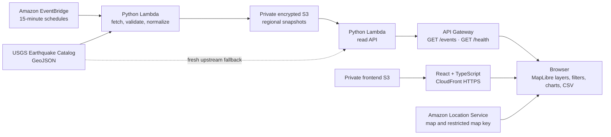

# QuakeWatch AI architecture

## Current system shape

The diagram describes the CDK-defined deployment, **not an already deployed
system**. In the verified local development mode, the browser queries USGS
directly and displays an explicitly labelled OpenStreetMap preview. The
Amazon Location map and AWS data path require deployment and live verification.

## Data flow

1. EventBridge invokes ingestion Lambda for India and global regions every 15
   minutes.
2. The Lambda fetches GeoJSON from the USGS FDSN Event Web Service with
   bounded timeouts/retries, validates the response, normalizes usable point
   features, removes duplicate event IDs, and writes a regional snapshot only
   after a successful fetch.
3. API Gateway exposes read-only `GET /events?region=india|global` and
   `GET /health`. The API Lambda serves the S3 snapshot or refreshes from
   USGS. On upstream failure it may serve a validated snapshot for up to six
   hours and marks it stale; otherwise it returns an error rather than
   inventing records.
4. The React application applies interactive filters and renders event
   markers, clusters, the optional density layer, analytics, and CSV export.
   Each event retains its USGS ID and source link.

See [DATA_SOURCE.md](./DATA_SOURCE.md) for query bounds, normalization, and
attribution, and the root README for API response details.

## AWS boundaries and security

- The data-snapshot and frontend buckets are private, encrypted, and block
  public access. CloudFront uses Origin Access Control for the static site.
- Lambda roles are scoped to the required snapshot access. API Gateway is
  read-only and throttled; Lambda concurrency and log retention are bounded.
- The Amazon Location API key is browser-visible by design, restricted to map
  rendering, the intended map resource, and the CloudFront referrer, and has
  an expiry. It is not an AWS credential or a server-side secret.
- USGS catalog data is public. API CORS is public for this data and does not
  provide authentication.
- No user accounts, private user data, uploads, or earthquake prediction
  capability are implemented.

## Local and deployed configuration

Local development needs Node.js/npm and Python, plus network access to USGS.
`VITE_API_BASE_URL` optionally selects the local Python API; otherwise the
browser calls USGS directly. Local OSM mode is not represented as an AWS map.

The deployed frontend is configured at build time with API Gateway, AWS
region, Amazon Location map name, and a restricted Location key. The deployment
script obtains stack outputs and the key from the configured AWS account,
builds the production frontend, publishes to S3, invalidates CloudFront, and
checks the HTTPS page and API health. The key is not printed.

## Cost and operational notes

Potential usage charges include Amazon Location requests, CloudFront transfer
and requests, API Gateway, Lambda, S3, EventBridge, CloudWatch, and CDK
bootstrap resources. Actual costs depend on account, region, usage, and
current prices. The stack retains its S3 buckets. No fixed cost or live
deployment is asserted. Review [AWS cost and security notes](./aws-costs-and-security.md)
and configure a budget before deployment.
